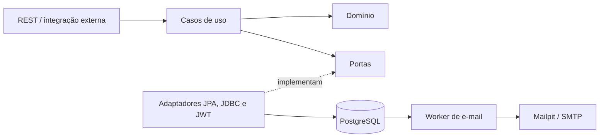
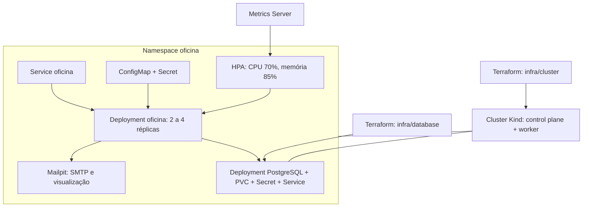
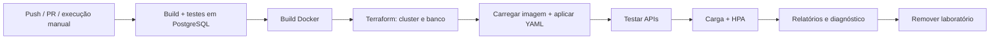

# Tech Challenge Oficina Mecânica

API REST para gerenciar clientes, veículos, serviços, peças e o ciclo de vida de ordens de serviço. A segunda fase acrescenta arquitetura hexagonal, aprovação externa de orçamento, notificações de status e infraestrutura reproduzível com Kubernetes, Terraform e GitHub Actions.

## Funcionalidades das fases 1 e 2

### Base da fase 1

- Cadastro e manutenção de clientes e veículos.
- Catálogo de serviços e peças, com ativação e desativação.
- Estoque com entrada, saída, baixa na aprovação e devolução no cancelamento quando aplicável.
- Abertura de OS, composição e recálculo de orçamento.
- Aprovação e recusa administrativa de orçamento.
- Controle das transições de status, finalização, entrega e cancelamento.
- Consultas por número, cliente, veículo e status; acompanhamento público por número da OS e placa.
- Indicadores de duração e tempo médio de execução.
- Autenticação administrativa com JWT, validação de dados e respostas de erro padronizadas.
- Swagger/OpenAPI, testes, cobertura e execução com Docker Compose.

```text
RECEBIDA -> EM_DIAGNOSTICO -> AGUARDANDO_APROVACAO
         -> EM_EXECUCAO -> FINALIZADA -> ENTREGUE
```

A recusa retorna a OS ao diagnóstico. O cancelamento segue as regras do domínio e pode devolver as peças ao estoque.

### Evolução na fase 2

- Portas e adaptadores, domínio independente de JPA e testes de arquitetura.
- Fila operacional ordenada por prioridade e antiguidade, mantendo as consultas históricas.
- Decisão externa de orçamento com chave própria, versão e proteção contra repetição.
- E-mails de status persistidos em outbox, com novas tentativas de envio.
- Migrations Flyway e validação do schema pelo Hibernate.
- Kubernetes, Terraform, probes, HPA, teste de carga e pipeline de build, testes e deploy.

A rota de listagem geral passou a representar a fila operacional. As consultas individuais e por cliente, veículo e status preservam o acesso ao histórico. As rotas administrativas de aprovação e recusa continuam disponíveis ao lado da nova integração externa.

## Arquitetura



O domínio não depende de Spring ou JPA. O mapeamento de persistência fica em `META-INF/orm.xml`; as regras de estoque, orçamento e transição de status permanecem no domínio. A aplicação usa portas para persistência, consulta entre contextos, tokens e notificações. As mensagens de status são registradas na mesma transação da OS e enviadas posteriormente.

A infraestrutura usa Kind com dois nós, PostgreSQL com volume persistente, duas a quatro réplicas da aplicação, Services, ConfigMaps, Secrets, probes, HPA e Metrics Server. O banco local tem uma réplica; o ambiente serve à demonstração acadêmica e não representa uma implantação de produção com banco redundante.

Os desenhos de componentes, infraestrutura e fluxo de deploy, decisões e instruções detalhadas estão em [Arquitetura e operação da fase 2](docs/FASE-2.md).

### Infraestrutura provisionada



### Fluxo de deploy



## Tecnologias

Java 21, Spring Boot 3.5, Maven, PostgreSQL 16, Flyway, Spring Security/JWT, JUnit, Mockito, ArchUnit, JaCoCo, Docker Distroless não-root, Kubernetes, Terraform, GitHub Actions, SMTP/Mailpit e k6.

## Execução local com Compose

Pré-requisitos: Docker em execução e Python 3 para gerar a configuração local.

```powershell
python scripts/configure-local.py
docker compose config --quiet
docker compose up --build -d
```

O gerador cria `.env` com credenciais aleatórias e preserva arquivos existentes. Há também um [.env.example](.env.example) para configuração manual. Em arquivos antigos, configure `INTEGRATION_TOKEN` e use `JPA_DDL_AUTO=validate`.

- API: `http://localhost:8080`.
- Swagger: [documentação interativa](http://localhost:8080/swagger-ui.html).
- E-mails capturados: [Mailpit](http://localhost:8025).
- Prontidão: `http://localhost:8080/actuator/health/readiness`.

As credenciais administrativas estão no `.env`. Os e-mails do Mailpit ficam no laboratório; não são enviados aos clientes reais. O Compose da fase 2 utiliza um volume novo e preserva o volume da primeira fase.

```powershell
python scripts/smoke-test.py
docker compose stop
```

O smoke test cria dados de demonstração, abre uma OS, envia aprovações simultâneas e repete o mesmo evento, confere o estoque, finaliza, entrega e consulta o histórico.

## Execução sem container da aplicação

Com Java 21 e Maven 3.9+, configure as variáveis de banco e credenciais no ambiente do processo. O Spring Boot não lê `.env` automaticamente; o Compose e os scripts Python fazem essa leitura.

```powershell
mvn -B -ntp verify
java -jar target/tech-challenge-oficina-1.0.0-SNAPSHOT.jar
```

Por padrão, a conexão aponta para PostgreSQL em `localhost:5432/oficina`. Flyway cria e evolui o schema. Para notificações, configure `NOTIFICACOES_ENABLED=true`, `SMTP_HOST`, `SMTP_PORT` e, se necessário, `SMTP_USERNAME`, `SMTP_PASSWORD`, `SMTP_AUTH` e `SMTP_STARTTLS`.

## Autenticação e configuração

Use as credenciais administrativas definidas no `.env` para fazer login:

```http
POST /api/auth/login
Content-Type: application/json
```

```json
{
  "email": "usuario@exemplo.com",
  "senha": "sua-senha"
}
```

O exemplo é ilustrativo. Nas chamadas administrativas, envie `Authorization: Bearer SEU_TOKEN`. No Swagger, use **Authorize**. A integração externa usa `X-Integration-Key`; o acompanhamento público usa número da OS e placa.

| Variável | Uso |
|---|---|
| `SPRING_DATASOURCE_URL` | URL JDBC; padrão local `jdbc:postgresql://localhost:5432/oficina` |
| `SPRING_DATASOURCE_USERNAME` / `SPRING_DATASOURCE_PASSWORD` | Credenciais JDBC |
| `POSTGRES_DB` / `POSTGRES_USER` / `POSTGRES_PASSWORD` | Banco e credenciais do Compose |
| `APP_PORT` / `POSTGRES_PORT` | Portas publicadas pelo Compose |
| `ADMIN_EMAIL` / `ADMIN_PASSWORD` | Administrador inicial |
| `JWT_SECRET` | Chave Base64 com pelo menos 256 bits |
| `JWT_EXPIRATION_MINUTES` | Validade do JWT; padrão de 60 minutos |
| `INTEGRATION_TOKEN` | Chave exclusiva de integração com pelo menos 32 caracteres |
| `JPA_DDL_AUTO` | `validate`; Flyway é responsável pelas migrations |
| `JPA_SHOW_SQL` | Exibição de SQL; padrão `false` |
| `SWAGGER_ENABLED` | Habilita Swagger e OpenAPI; padrão `true` |
| `NOTIFICACOES_ENABLED` | Habilita o worker de e-mails |
| `SMTP_HOST` / `SMTP_PORT` | Servidor SMTP |
| `SMTP_USERNAME` / `SMTP_PASSWORD` | Credenciais SMTP, quando necessárias |
| `SMTP_AUTH` / `SMTP_STARTTLS` | Autenticação e STARTTLS |
| `SMTP_FROM` | Remetente das notificações |

Não versione credenciais. Configure senhas e chave JWT próprias por ambiente. Fora do laboratório, use HTTPS e restrinja a documentação interativa conforme o ambiente. Os erros da API diferenciam validação, recurso inexistente, conflito e falhas internas, sem expor stack traces ao cliente.

## Organização do código

- `domain`: entidades, agregados, enums e regras de negócio.
- `application`: casos de uso, portas, DTOs, validações e mapeadores.
- `infrastructure`: persistência, JWT, integração, notificações e configurações.
- `interfaces/controller`: endpoints REST e tratamento de erros.
- `src/main/resources/META-INF/orm.xml`: mapeamento JPA.
- `src/main/resources/db/migration`: evolução do schema.
- `infra` e `k8s`: provisionamento e manifestos.
- `scripts` e `.github/workflows`: operação, validação e CI/CD.

`OrdemServico` é o agregado principal do fluxo. As coleções de itens usam `LinkedHashSet`. Os limites e invariantes estão descritos na documentação de domínio.

## APIs

O [contrato OpenAPI completo](docs/openapi.json) pode ser importado no Postman. Com a aplicação iniciada, o mesmo contrato está em `/v3/api-docs`.

| Recurso | Endpoint | Acesso |
|---|---|---|
| Login | `POST /api/auth/login` | Público |
| Clientes | `/api/clientes` | JWT administrativo |
| Veículos | `/api/veiculos` | JWT administrativo |
| Serviços | `/api/servicos` | JWT administrativo |
| Peças e estoque | `/api/pecas` | JWT administrativo |
| Abertura de OS | `POST /api/ordens-servico` | JWT administrativo |
| Fila operacional | `GET /api/ordens-servico` | JWT administrativo |
| Consulta individual | `GET /api/ordens-servico/{id}` | JWT administrativo |
| Diagnóstico | `POST /api/ordens-servico/{id}/diagnostico` | JWT administrativo |
| Envio do orçamento | `POST /api/ordens-servico/{id}/orcamento/enviar-aprovacao` | JWT administrativo |
| Decisão externa | `POST /api/integracoes/ordens-servico/{id}/aprovacao` | `X-Integration-Key` |
| Acompanhamento | `GET /api/publico/ordens-servico/{numeroOs}?placa=...` | Público, com número e placa |

A fila segue `EM_EXECUCAO > AGUARDANDO_APROVACAO > EM_DIAGNOSTICO > RECEBIDA`, com as mais antigas primeiro. OS finalizadas, entregues e canceladas ficam fora da fila, mas continuam no histórico.

A integração externa recebe `eventoId`, `versaoOrcamento`, `aprovada` e `observacao`. Repetir o mesmo evento não baixa estoque novamente. Cada reenvio de orçamento gera uma nova versão, retornada pela API. O [guia da fase 2](docs/FASE-2.md) explica os contratos, códigos HTTP e garantias de entrega.

## Kubernetes e Terraform

Instale Terraform, Kind e kubectl e mantenha Docker em execução. O [guia de operação](docs/FASE-2.md#provisionamento-local) detalha versões, recursos e acesso.

```powershell
terraform -chdir=infra/cluster init
terraform -chdir=infra/cluster apply
terraform -chdir=infra/database init
terraform -chdir=infra/database apply
docker build -t tech-challenge-oficina:local .
python scripts/deploy-local.py
kubectl --kubeconfig infra/cluster/kubeconfig -n oficina port-forward service/oficina 8080:8080
```

Os manifestos estão em [k8s](k8s) e os módulos em [infra](infra). Para observar escala automática, execute `python scripts/check-hpa.py`; o script gera carga com k6 e registra métricas e réplicas em `target/cluster`.

## Testes e pipeline

```powershell
mvn -B -ntp verify
```

A suíte cobre domínio, casos de uso, autenticação, integração externa, fila operacional, persistência, notificações e fronteiras arquiteturais. Os testes locais de banco usam H2 em modo PostgreSQL. No pipeline, `TEST_DATABASE_URL`, `TEST_DATABASE_DRIVER`, `TEST_DATABASE_USER` e `TEST_DATABASE_PASSWORD` direcionam os mesmos testes para PostgreSQL real.

O JaCoCo gera `target/site/jacoco/index.html` e exige pelo menos 80% de cobertura por instruções no domínio. Esse limite não é uma medida de cobertura global.

O [workflow CI/CD](.github/workflows/ci-cd.yml) executa build, testes em PostgreSQL, build da imagem, Terraform, deploy de banco/aplicação, smoke test e carga com HPA. O cluster é descartável e fica no executor do GitHub Actions. Relatórios são publicados como artefatos; não há deploy cloud permanente.

## Entrega

- [Arquitetura e operação](docs/FASE-2.md).
- [Contrato das APIs](docs/openapi.json).
- [Vídeo da demonstração](https://youtu.be/DhPLDU__Fzk).

Para gerar o PDF, instale `reportlab` e execute:

```powershell
python scripts/gerar-entrega.py --video-url URL_DO_VIDEO --output target/entrega-fase-2.pdf
```

O PDF do portal precisa conter o link deste repositório, a arquitetura e o link real do vídeo. O acesso do usuário `soat-architecture` deve ser conferido antes do envio.

O [modelo de domínio](docs/modelo-dominio.md) e os documentos [Linguagem Ubíqua](docs/LINGUAGEM-UBIQUA.md), [Event Storming de OS](docs/EVENT-STORMING-ORDEM-SERVICO.md) e [Event Storming de Peças](docs/EVENT-STORMING-PECAS-INSUMOS.md) registram a modelagem inicial.

## Documentação da fase 1

O material original foi preservado como histórico. As instruções atuais de execução e arquitetura estão neste README e em [FASE-2.md](docs/FASE-2.md).

- [README da fase 1](docs/fase-1/README.md).
- [Diagramas DDD e arquitetura inicial](docs/fase-1/DIAGRAMAS-DDD.md).
- [Endpoints e exemplos originais](docs/fase-1/ENDPOINTS.md).
- [Arquitetura inicial](docs/fase-1/arquitetura.md).
- [Relatório de vulnerabilidades da fase 1](docs/fase-1/RELATORIO-VULNERABILIDADES.md).
- [Revisão da primeira entrega](docs/fase-1/REVISAO-FINAL.md).

Os relatórios históricos mantêm as datas originais para identificar a execução à qual se referem. Seus resultados não constituem um novo scan da imagem da fase 2.
