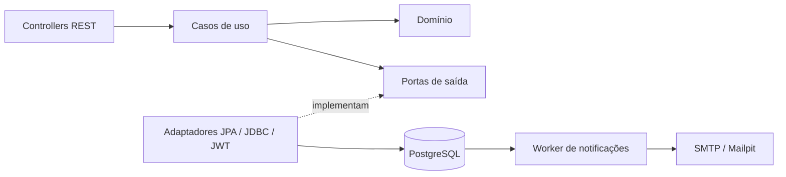
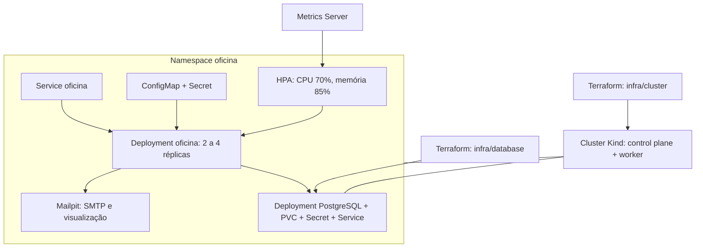
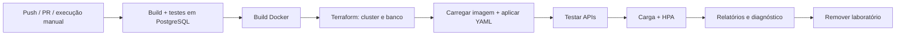

# Fase 2: arquitetura e operação

## Decisões de arquitetura

A aplicação continua sendo um monólito, com portas e adaptadores. O domínio contém as regras de negócio e não importa Spring, JPA ou classes das demais camadas. Os casos de uso dependem de interfaces de persistência, consulta de cadastros, emissão de tokens e notificações. Os adaptadores conectam essas interfaces ao PostgreSQL, JWT e SMTP.

O mapeamento JPA está em `src/main/resources/META-INF/orm.xml`. Essa opção mantém os objetos de domínio independentes de JPA sem duplicar o modelo inteiro. A infraestrutura continua usando o gerenciamento de transações e o acompanhamento de alterações do Hibernate. As coleções de itens da OS permanecem como `LinkedHashSet`.

Spring fornece injeção de dependências e transações na camada de aplicação. O teste `ArquiteturaTest` impede dependências do domínio para camadas externas e dependências da aplicação para infraestrutura ou controllers.



Os contextos de Clientes e Veículos, Catálogo, Peças e Estoque, Ordens de Serviço e Identidade permanecem no mesmo processo e banco. As consultas entre módulos passam por portas. O modelo ainda compartilha referências a entidades entre contextos; a extração de um microserviço exigiria substituir essas referências por contratos próprios e rever a transação de estoque. Essa separação física não é necessária para a fase 2.

## Fluxos da oficina

### Fila de ordens

`GET /api/ordens-servico` retorna apenas a fila operacional, nesta ordem:

1. `EM_EXECUCAO`.
2. `AGUARDANDO_APROVACAO`.
3. `EM_DIAGNOSTICO`.
4. `RECEBIDA`.

Dentro de cada grupo, as mais antigas aparecem primeiro; o ID desempata datas iguais. Finalizadas, entregues e canceladas continuam no banco e nas consultas individuais e históricas. Canceladas ficam fora da fila porque não representam trabalho em andamento.

### Abertura e acompanhamento

`POST /api/ordens-servico` recebe os IDs de cliente e veículo, os serviços e as peças. Os cadastros devem existir previamente. A resposta `201` contém `id`, `numeroOs` e o orçamento calculado. Quando a abertura já inclui itens, o fluxo existente inicia o diagnóstico automaticamente.

Uma OS sem itens pode entrar em diagnóstico por `POST /api/ordens-servico/{id}/diagnostico`. O acompanhamento público continua em `GET /api/publico/ordens-servico/{numeroOs}?placa=...`, com dados restritos ao andamento.

### Aprovação externa

O envio para aprovação retorna `versaoOrcamento`. Cada reenvio de orçamento incrementa essa versão. A integração informa a versão recebida para impedir que uma decisão antiga aprove um orçamento revisado.

```http
POST /api/integracoes/ordens-servico/1/aprovacao
X-Integration-Key: TOKEN_DA_INTEGRACAO
Content-Type: application/json
```

```json
{
  "eventoId": "89236a1f-61e5-4d14-b368-047b54fbff50",
  "versaoOrcamento": 1,
  "aprovada": true,
  "observacao": "Serviço autorizado"
}
```

- `204`: decisão processada ou repetição idêntica de evento já confirmado.
- `400`: dados inválidos ou campos obrigatórios ausentes.
- `401`: credencial de integração ausente ou inválida.
- `404`: OS inexistente.
- `409`: versão antiga, estado incompatível ou evento reutilizado com outros dados.

A recusa usa `aprovada: false` e exige uma observação. A OS volta ao diagnóstico. A aprovação inicia a execução e baixa as peças uma única vez. O registro do evento, a alteração da OS, o estoque e a notificação pertencem à mesma transação. O bloqueio da OS serializa decisões externas concorrentes; versões otimistas de OS e peça protegem as outras alterações.

`INTEGRATION_TOKEN` deve ter ao menos 32 caracteres e é diferente do JWT administrativo. Sem um token válido configurado, a rota recusa todas as chamadas. Para uso fora do ambiente local, o tráfego deve passar por HTTPS.

### E-mails de status

O requisito de atualização por uma ferramenta externa foi implementado como aviso por e-mail a cada criação ou mudança de status da OS. A resposta do cliente entra pelo endpoint de integração; não há processamento de mensagens recebidas por uma caixa de e-mail.

As mensagens são gravadas na tabela `notificacoes` dentro da transação de negócio. Um worker consulta até dez registros por lote usando `FOR UPDATE SKIP LOCKED`, permitindo execução em várias réplicas. Falhas de SMTP ficam pendentes para nova tentativa após 60 segundos. O Mailpit captura os e-mails no ambiente local, sem enviar mensagens para pessoas reais.

O envio possui garantia de pelo menos uma tentativa até o sucesso, com possibilidade de duplicação se o SMTP aceitar a mensagem e o processo cair antes de confirmar a transação. O worker não promete entrega exatamente uma vez. Mensagens enviadas e tentativas permanecem na tabela para consulta; retenção e monitoramento operacional devem ser definidos antes de uso em produção.

## Infraestrutura



O cluster é local e destinado à avaliação. O módulo `infra/cluster` usa `terraform_data` com a CLI Kind para criar e remover os nós Docker. Essa escolha exige Kind no `PATH` e não detecta automaticamente uma remoção manual do cluster; nesse caso, recrie o recurso com `terraform apply -replace=terraform_data.cluster` após conferir o estado local.

O módulo `infra/database` usa o provider Kubernetes para gerenciar namespace, senha, Secret, PVC, Service e Deployment do PostgreSQL. Os YAML do banco ficam em `k8s/database` e são consumidos pelo Terraform. Não aplique esses mesmos recursos manualmente com `kubectl` quando o Terraform for o responsável pelo ambiente.

O banco tem uma réplica e volume persistente, com estratégia `Recreate`. Isso evita dois processos escrevendo no mesmo diretório, mas não fornece alta disponibilidade do banco. O armazenamento do Kind fica nos containers dos nós e é perdido quando o cluster é removido. Uma implantação de produção exigiria banco com redundância, backups, armazenamento adequado e gestão externa de segredos.

A aplicação executa como usuário 65532, com sistema de arquivos somente leitura, diretório temporário dedicado, limites de CPU/memória e probes separadas. A readiness verifica também o banco; a liveness não depende de SMTP ou PostgreSQL. O HPA depende do Metrics Server e das reservas de recursos dos containers.

## Provisionamento local

Pré-requisitos: Docker em execução, Java 21, Maven 3.9+, Python 3, Terraform 1.5+ (validado com 1.13.3), Kind 0.29.0 e kubectl compatível com Kubernetes 1.33. Reserve recursos suficientes para dois nós, PostgreSQL, aplicação e teste de carga; cerca de 8 GB disponíveis para o Docker é uma referência para a demonstração.

Execute na raiz do repositório:

```powershell
python scripts/configure-local.py
mvn -B -ntp verify
docker build -t tech-challenge-oficina:local .
terraform -chdir=infra/cluster init
terraform -chdir=infra/cluster apply
terraform -chdir=infra/database init
terraform -chdir=infra/database apply
python scripts/deploy-local.py
```

O arquivo `.env` é criado com credenciais aleatórias somente se não existir. Para um `.env` antigo, acrescente `INTEGRATION_TOKEN` e altere `JPA_DDL_AUTO` para `validate`. O script de deploy lê esse arquivo e cria o Secret da aplicação sem imprimir seu conteúdo. A senha do banco do cluster é gerada pelo Terraform e não é a senha do PostgreSQL do Compose.

O kubeconfig fica em `infra/cluster/kubeconfig`, sem alterar o arquivo global do usuário. O estado Terraform contém material sensível e está ignorado pelo Git. Guarde-o com acesso restrito; não publique estado, `.env` ou kubeconfig como evidência.

O script instala Metrics Server 0.8.0 e habilita `--kubelet-insecure-tls` para os certificados locais do Kind. Essa exceção é específica do laboratório.

Em terminais separados:

```powershell
kubectl --kubeconfig infra/cluster/kubeconfig -n oficina port-forward service/oficina 8080:8080
kubectl --kubeconfig infra/cluster/kubeconfig -n oficina port-forward service/mailpit 8025:8025
```

- Swagger: `http://localhost:8080/swagger-ui.html`.
- Mailpit: `http://localhost:8025`.
- Verificação do fluxo: `python scripts/smoke-test.py`.

Após mudar o código, use uma nova tag de imagem para que o Kubernetes faça o rollout:

```powershell
docker build -t tech-challenge-oficina:revisao-2 .
python scripts/deploy-local.py --image tech-challenge-oficina:revisao-2
```

Para encerrar o laboratório, os comandos abaixo removem também os dados desse ambiente:

```powershell
terraform -chdir=infra/database destroy
terraform -chdir=infra/cluster destroy
```

## Escalabilidade

Com o deploy pronto:

```powershell
python scripts/check-hpa.py
```

O script publica um Job k6 que faz login e consulta as OS por quatro minutos. Ele registra métricas e réplicas, verifica se o Job terminou sem erros e exige observar escala acima do mínimo de duas réplicas com métricas válidas. Os resultados ficam em `target/cluster/hpa.json` e `target/cluster/carga.log`.

Para acompanhar visualmente:

```powershell
kubectl --kubeconfig infra/cluster/kubeconfig -n oficina get hpa,pods -w
kubectl --kubeconfig infra/cluster/kubeconfig -n oficina top pods
```

Se não houver escala, consulte `kubectl describe hpa oficina -n oficina --kubeconfig infra/cluster/kubeconfig`, a disponibilidade de métricas e a capacidade do Docker.

## CI/CD



O workflow `.github/workflows/ci-cd.yml` cria um ambiente descartável no executor do GitHub Actions. Ele faz o deploy completo nesse cluster, incluindo PostgreSQL, e remove os recursos ao terminar. Não há publicação em registry ou ambiente cloud permanente.

Os testes usam PostgreSQL 16 no pipeline. Sem as variáveis `TEST_DATABASE_*`, a suíte local usa H2 em modo PostgreSQL. H2 permite verificar mappings e fluxos, mas não substitui a execução em PostgreSQL para validar diferenças de SQL e concorrência.

## Evolução de banco existente

O Compose da fase 2 usa o volume `oficina-fase2-postgres-data`, preservando o volume anterior. Bancos novos são criados pelas migrations Flyway; Hibernate apenas valida o schema.

Para reutilizar dados da fase 1, faça backup e compare o schema com `V1__schema_inicial.sql` em uma cópia do banco. Se forem compatíveis, registre o baseline 1 usando Flyway e aplique V2/V3. Não habilite `baseline-on-migrate` indiscriminadamente: ele poderia aceitar um schema incompatível. V3 acrescenta as versões da OS e do orçamento; orçamentos antigos devem ser reenviados para obter uma versão válida para a integração.

## Referências técnicas

- [Inicialização de banco e Flyway no Spring Boot](https://docs.spring.io/spring-boot/3.5/how-to/data-initialization.html).
- [Kind: criação de cluster e carregamento de imagens](https://kind.sigs.k8s.io/docs/user/quick-start/).
- [Horizontal Pod Autoscaler](https://kubernetes.io/docs/tasks/run-application/horizontal-pod-autoscale-walkthrough/).
- [Metrics Server](https://kubernetes-sigs.github.io/metrics-server/).
